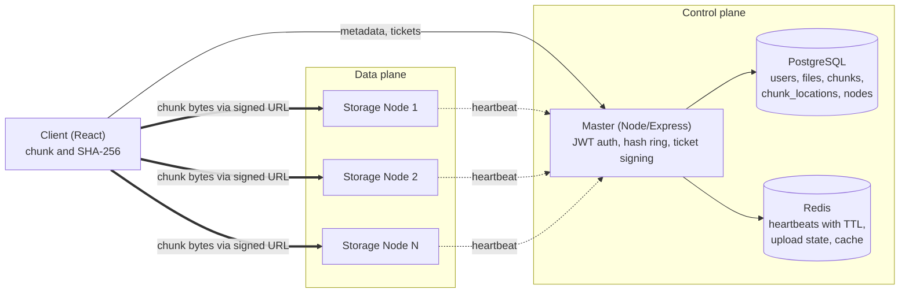
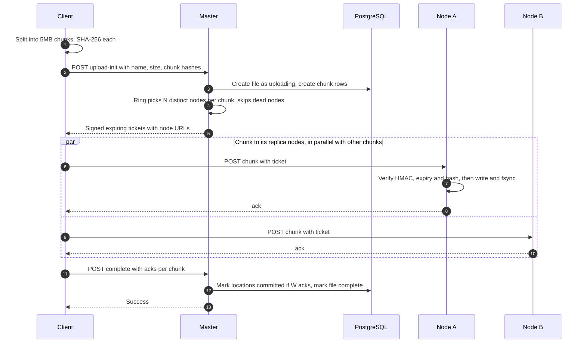
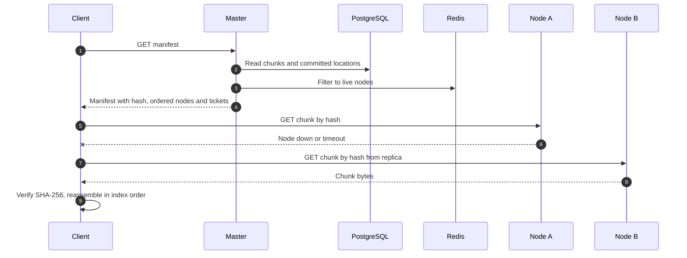
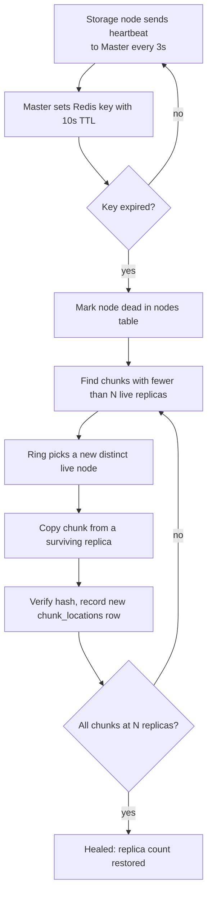

# Distributed-File-Storage-System

A scaled-down implementation of a GFS/HDFS-style distributed file store. Files are split into chunks, spread across storage nodes with consistent hashing, replicated, and recovered automatically when a node dies.

> **Status: in progress.** See the [Project Status](#project-status) table for what is built and what is only designed. Diagrams below show the **target design**.

---

## Table of Contents

1. [Overview](#overview)
2. [Project Status](#project-status)
3. [Architecture](#architecture)
4. [How It Works](#how-it-works)
5. [Key Design Decisions](#key-design-decisions)
6. [Tech Stack](#tech-stack)
7. [Data Model](#data-model)
8. [API](#api)
9. [Repository Structure](#repository-structure)
10. [Running Locally](#running-locally)
11. [Benchmarks](#benchmarks)
12. [Failure Experiments](#failure-experiments)
13. [Known Limitations](#known-limitations)
14. [Roadmap](#roadmap)
15. [References](#references)

---

## Overview

A single server storing files has three limits: its disk fills up, it is a single point of failure, and its network card caps throughput. This project spreads files over many storage nodes and answers the problems that creates:

- **Where does each piece live?** Consistent hashing with virtual nodes decides placement.
- **What if a machine dies?** Chunks are replicated, failures are detected by heartbeats, and missing replicas are re-created automatically.
- **How do we avoid a new bottleneck?** The Master only handles small metadata requests. File bytes flow directly between clients and storage nodes.
- **How do we keep data correct?** Every chunk is verified with SHA-256 on upload and on download.

This is a learning-scale system. The algorithms are real implementations, while the hardware and network are simulated with Docker containers on one machine. See [Known Limitations](#known-limitations).

---

## Project Status

Update this table as work progresses. Nothing is marked done until it works end to end and has a test or benchmark behind it.

| Component | Status |
|---|---|
| Docker Compose infra (Postgres, Redis, storage nodes) | Planned |
| Master: auth, schema, upload-init | Planned |
| Consistent hash ring with virtual nodes | Planned |
| Signed upload tickets and parallel client upload | Planned |
| Download manifest, failover, hash verification | Planned |
| Heartbeats and dead-node detection | Planned |
| Write quorum and automatic re-replication | Planned |
| Benchmarks and failure experiments | Planned |
| Resumable uploads, chaos dashboard | Stretch |

Status values: `Planned`, `In progress`, `Done`, `Stretch`.

---

## Architecture

The core principle is the separation of the **control plane** (metadata, small and cheap) from the **data plane** (file bytes, large and expensive). A 1 GB upload never passes through the Master, so the Master does not become a bandwidth bottleneck.



| Component | Role |
|---|---|
| **Client** | Splits files into 5 MB chunks, hashes each chunk, uploads and downloads in parallel, verifies and reassembles. |
| **Master** | Authenticates users, keeps the file registry, runs the hash ring, signs expiring tickets, monitors node health, triggers re-replication. |
| **Storage nodes** | Simple chunk stores: store a chunk, return a chunk, send heartbeats. They hold no global knowledge. |
| **PostgreSQL** | Durable source of truth for metadata. |
| **Redis** | Soft state: heartbeats (TTL keys), in-progress upload state, caches. Safe to lose. |

---

## How It Works

### Upload flow



### Download flow



### Self-healing flow



---

## Key Design Decisions

| # | Decision | Choice | Why |
|---|---|---|---|
| 1 | Placement vs. truth | **Placement uses the ring. Reads and healing use `chunk_locations` only.** | The ring's answer depends on current membership, so it changes when nodes join or leave. Postgres records where data actually is. The gap between the two (desired vs. actual) is what the re-replication loop closes. |
| 2 | Hash ring | Virtual nodes (about 150 per node), sorted array, binary search lookup | One point per node gives uneven load because random arcs are unequal. Virtual nodes average this out and spread a dead node's load across all survivors. |
| 3 | Replica selection | Walk clockwise until N **distinct physical nodes** are found | Adjacent virtual nodes often belong to the same machine. Without the skip, replicas could share a machine and die together. |
| 4 | Ring and health | Ring depends on membership only. The Master filters by liveness from Redis. | Keeps the ring a pure, testable function. |
| 5 | Who writes replicas | **Proposed:** client fan-out to the replica nodes | Simpler to debug. Costs extra client upload bandwidth. Alternative: primary forwards. *Open until confirmed.* |
| 6 | Write quorum | **Proposed:** N = 3, W = 2 | A write survives one node failure. Trade-off documented under CAP below. *Open until benchmarked.* |
| 7 | Authorization to nodes | HMAC-signed, expiring tickets | Clients talk to nodes directly, so nodes must verify requests without calling the Master. |
| 8 | Integrity | SHA-256 per chunk, verified on write and on read | Detects corruption instead of silently returning bad data. Identical chunks hash identically, which enables dedup later. |
| 9 | Durability | Node acks only after data is flushed to disk (`fsync`) | An ack must mean the chunk is safe. Costs throughput, so it is benchmarked both ways. |
| 10 | Chunk size | 5 MB to start | Balance between parallelism and metadata overhead. Revisit after benchmarks. |

**Why consistent hashing when a central directory exists?** GFS and HDFS place chunks by free space and load, with no hash ring. Consistent hashing is chosen here as a deterministic, balanced placement policy that needs no per-node load tracking and has a principled answer for what moves when membership changes (about 1/N of keys). It is not strictly required by this architecture.

**CAP position (target):** with quorum writes (W = 2 of N = 3), writes stay available with one node down. If fewer than W nodes are reachable, writes fail rather than accept data that is not safely replicated. Reads fail over to any committed replica.

---

## Tech Stack

| Technology | Used for |
|---|---|
| **Node.js, Express** | Master and storage node HTTP services. Streams with backpressure keep memory flat for large chunks. |
| **React, Web Crypto API** | Client UI, `Blob.slice` chunking, SHA-256 hashing, bounded parallel upload pool. |
| **PostgreSQL** | Durable metadata with transactions and constraints. |
| **Redis** | Heartbeat keys with TTL, resumable upload state, caching. |
| **JWT** | User authentication (who you are). |
| **HMAC-SHA256 tickets** | Authorization for one chunk operation, with expiry (what you may do). |
| **Docker, Docker Compose** | Runs the whole cluster with one command and makes it easy to kill nodes on purpose. |

---

## Data Model

```text
users            (id, email, password_hash)
files            (id, user_id, filename, total_size, total_chunks, file_hash, status, created_at)
chunks           (id, file_id, chunk_index, chunk_hash, size)
nodes            (id, address, status, last_heartbeat)
chunk_locations  (chunk_id, node_id, status, created_at)
```

- `files.status`: `uploading`, `complete`, `failed`.
- `chunk_locations.status`: `pending` (ticket issued), `committed` (node acknowledged after flush), `lost` (node dead or chunk corrupt).
- Locations are rows rather than primary/replica columns, so the replica count is flexible and re-replication is just inserting a row.

---

## API

**Master**

| Method | Endpoint | Purpose |
|---|---|---|
| POST | `/api/auth/register`, `/api/auth/login` | User accounts, returns JWT |
| POST | `/api/files/upload-init` | Create a file record from name, size and chunk hashes |
| POST | `/api/files/:fileId/upload-tickets` | Ring placement plus signed tickets for each chunk |
| POST | `/api/files/:fileId/complete` | Record acknowledgements, commit locations |
| GET | `/api/files/:fileId/manifest` | Chunk hashes plus healthy node addresses and tickets |
| GET | `/api/admin/nodes` | Node list and health |
| GET | `/api/admin/distribution` | Chunk distribution across nodes |

**Storage node**

| Method | Endpoint | Purpose |
|---|---|---|
| POST | `/chunks` | Store a chunk (verifies ticket and hash) |
| GET | `/chunks/:hash` | Return a chunk |
| GET | `/health` | Liveness check |

---

## Repository Structure

Planned monorepo layout (one compose file, one history):

```text
.
├── master/            # Express API, hash ring, ticket signing, repair loop
├── storage-node/      # chunk store and heartbeat sender
├── client/            # React app: chunking, hashing, parallel transfer
├── scripts/           # benchmarks, fault injection, ring experiment
├── docs/              # design log, diagrams, benchmark results
├── docker-compose.yml
└── README.md
```

---

## Running Locally

> These are the target commands. They will work once the infra phase is complete.

Prerequisites: Docker and Docker Compose.

```bash
git clone <repo-url>
cd <repo>
docker compose up --build
```

This is intended to start PostgreSQL, Redis, the Master, and several storage nodes.

Kill a node to watch recovery:

```bash
docker kill <storage-node-container>
```

Benchmarks and fault-injection scripts will live in `scripts/`.

---

## Benchmarks

| Metric | Result | Setup |
|---|---|---|
| Load imbalance across nodes, 1 vnode | TBD | Ring simulation, 100k keys |
| Load imbalance across nodes, 150 vnodes | TBD | Same keys |
| Keys moved when one node is removed | TBD | Compared with `hash % N` |
| Upload throughput, 1 stream vs. 4 parallel | TBD | Same file, median of 3 runs |
| Memory usage for a 1 GB file with streaming | TBD | |
| Heartbeat detection time (death to marked dead) | TBD | |
| Time to restore replica count after a node kill | TBD | Report with data volume |

All containers share one machine, so throughput results are relative comparisons, not production figures.

---

## Failure Experiments

| Scenario | Expected | What actually happened | Fix |
|---|---|---|---|
| Kill a storage node mid-upload | TBD | TBD | TBD |
| Kill a storage node mid-download | TBD | TBD | TBD |
| Corrupt a stored chunk | TBD | TBD | TBD |
| Restart the Master | TBD | TBD | TBD |
| Network drop partway through a file | TBD | TBD | TBD |
| Replica write fails but another succeeds | TBD | TBD | TBD |

---

## Known Limitations

Stated up front, with what would change at larger scale.

| Limitation | At 100x scale |
|---|---|
| Master is a single point of failure | Replicated Master with leader election, or a consensus-backed metadata store |
| Containers on one machine: no independent hardware failure, no real network faults | Real multi-machine deployment, fault injection with tools such as Toxiproxy |
| Metadata in a single PostgreSQL instance | Sharded or replicated metadata store |
| No encryption at rest | Encrypted volumes or per-chunk encryption with key management |
| Full replication costs 3x storage | Erasure coding for cold data |

---

## Roadmap

Core first. Stretch items only after the core is finished and measured.

- [ ] Core: ring, tickets, parallel upload, quorum, failover, heartbeats, re-replication
- [ ] Benchmarks and failure experiments recorded
- [ ] Throttled re-replication, so repair does not starve foreground traffic
- [ ] Erasure coding as an alternative to replication
- [ ] Content-addressed deduplication with reference counting and garbage collection
- [ ] Integrity scrubber for background corruption detection
- [ ] Resumable uploads backed by Redis
- [ ] Chaos dashboard

---

## References

- Ghemawat, Gobioff, Leung. *The Google File System* (SOSP 2003)
- DeCandia et al. *Dynamo: Amazon's Highly Available Key-value Store* (SOSP 2007)
- Apache HDFS architecture documentation
- Karger et al. *Consistent Hashing and Random Trees* (1997)
